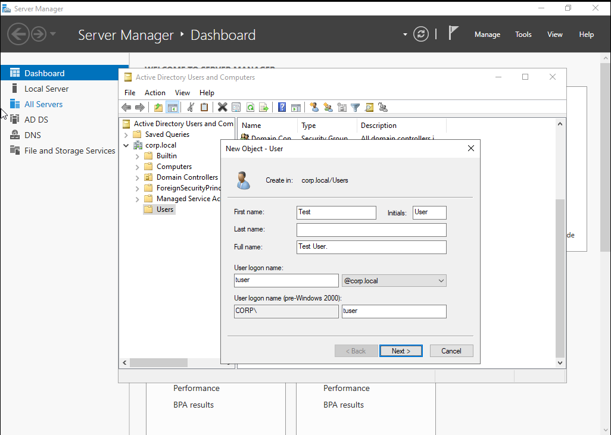
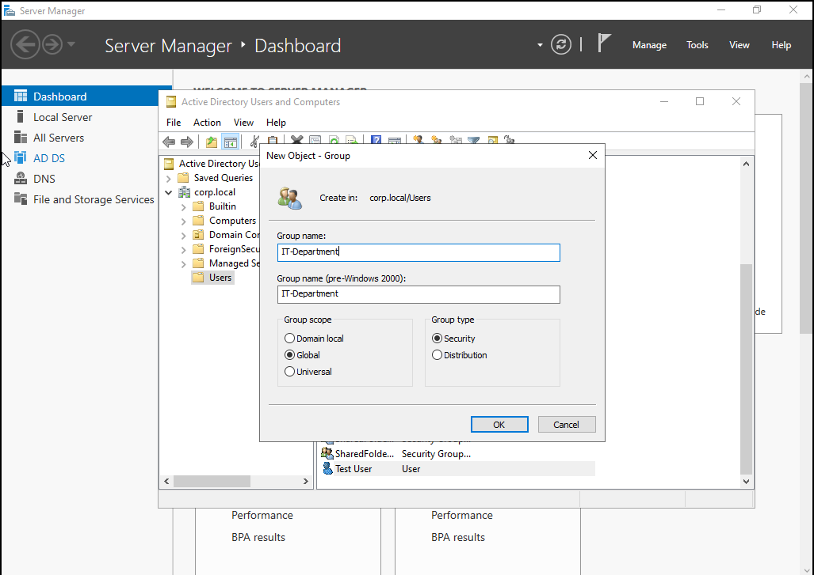
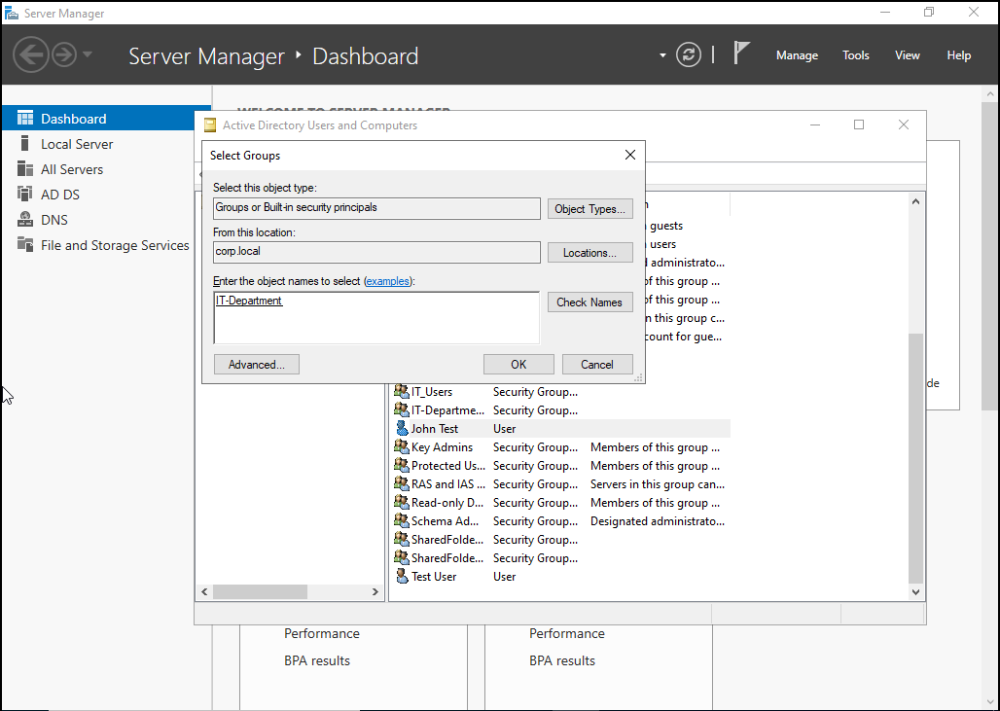
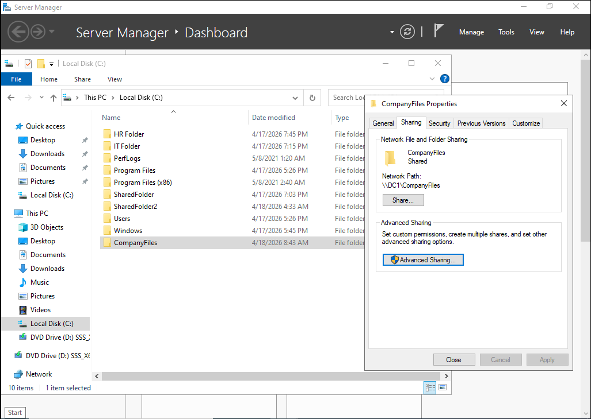
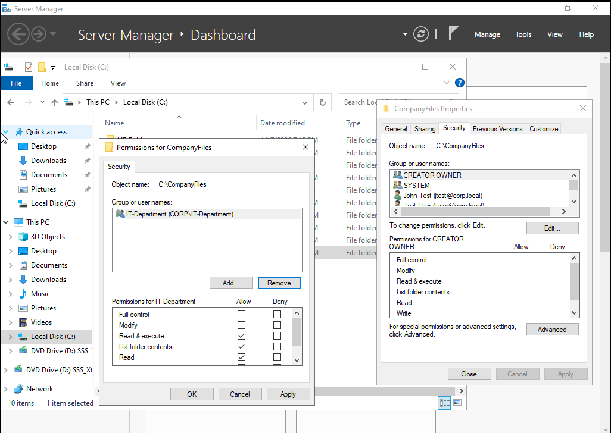
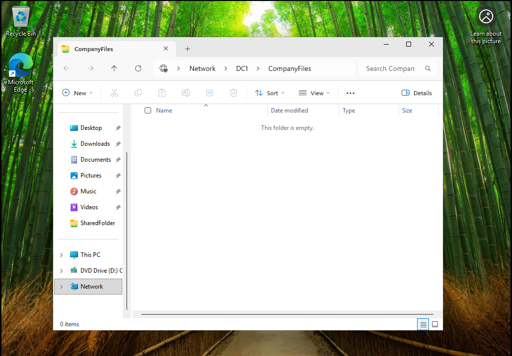

# Active Directory User and Group Management

## Operational Summary

| | |
|---|---|
| **Problem** | A new domain user needs access to a shared resource without managing access individually for every employee. |
| **Solution** | Provision the user in Active Directory, create a security group, add the user to that group, and configure permissions for the shared folder. |
| **Testing** | Review the user and group configuration, group membership, folder permissions, and the client-side access test shown below. |
| **Observed result** | The lab documents a successful shared-resource access test after group membership and permissions were configured. |
| **Scope** | Isolated Windows Server 2022 / domain-joined Windows client lab, not a production deployment. |

## Environment

- Windows laptop hosting VMware Workstation Player
- Windows Server 2022 domain controller (`DC1`)
- Windows 10/11 domain-joined client
- Active Directory domain: `corp.local`
- NAT virtual network
- Active Directory Users and Computers (ADUC)

## Implementation and Evidence

The screenshots follow the same order as the access-provisioning workflow.

### 1. Provision the domain user

Create the user account in Active Directory as the identity that will receive access.

### 2. Create a security group

Use a group to represent authorized users instead of assigning permissions individually.

### 3. Assign group membership

Add the provisioned user to the appropriate group.

### 4. Configure the network share

Create the folder that the user needs to access.

### 5. Configure permissions

Apply the required permissions to the shared resource. In an enterprise environment, evaluate both **share** and **NTFS** permissions, because effective access is constrained by both.

### 6. Validate end-user access

Test access from the domain-joined client using the provisioned identity.

## Validation and Outcome

| Check | Evidence | Documented outcome |
|---|---|---|
| Domain user provisioned | User creation screenshot | User account created |
| Security group configured | Group creation and membership screenshots | User added to group |
| Resource authorization | Folder and permissions screenshots | Group-based permissions configured |
| End-user access | Access-success screenshot | Access succeeded in the lab |

**Evidence boundary:** The screenshots support a positive access test. They do not, on their own, establish that unauthorized accounts were denied access or that permission revocation was tested. Those would be useful follow-up negative tests.

## Operational Relevance

This is the core access-request lifecycle for help desk and junior systems administration: **request → provision identity → assign group-based access → validate access → document the outcome**. Group-based authorization also makes later access reviews and offboarding easier than direct user-by-user folder permissions.

## Skills Demonstrated

Active Directory user provisioning, security group management, group membership, Windows file sharing, permission configuration, domain-client access validation, and technical evidence capture.

## Next Validation Steps

- Test the same share with a user **outside** the authorized group and record the expected access-denied result.
- Remove the authorized user's group membership, refresh the sign-in session, and confirm access is revoked.
- Record exact share and NTFS permission levels for repeatability.
