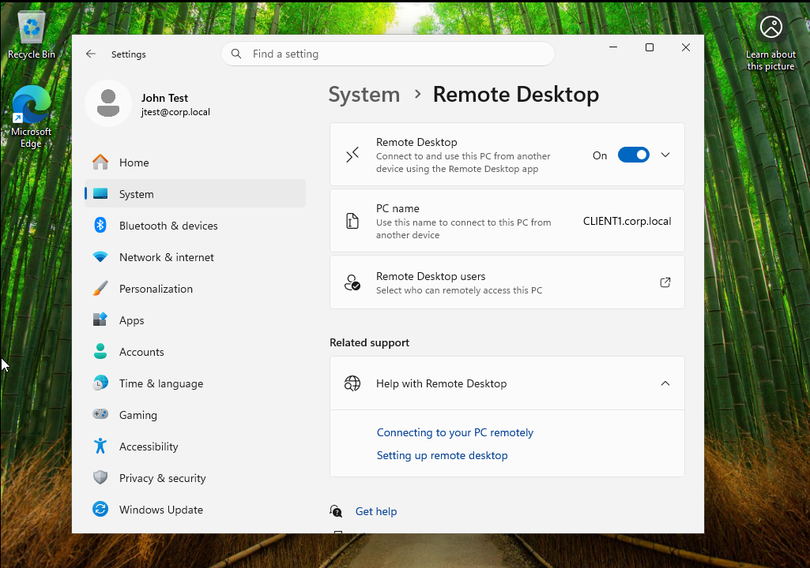
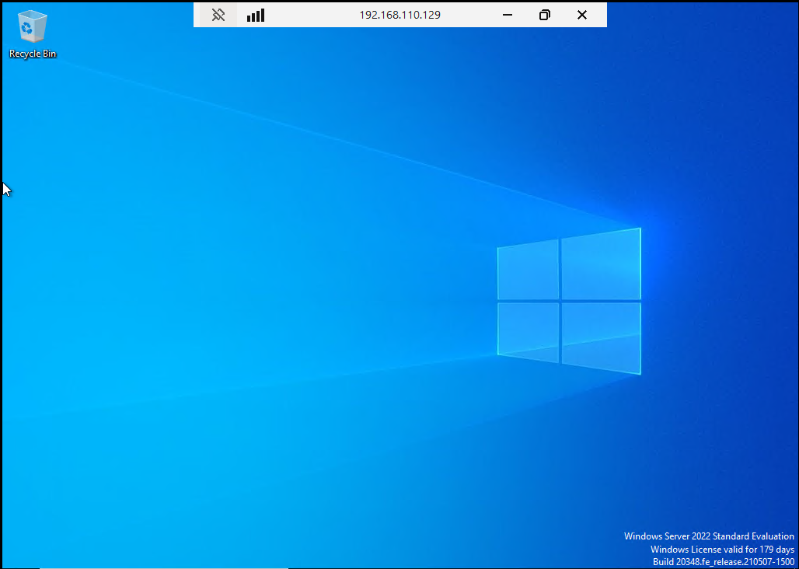
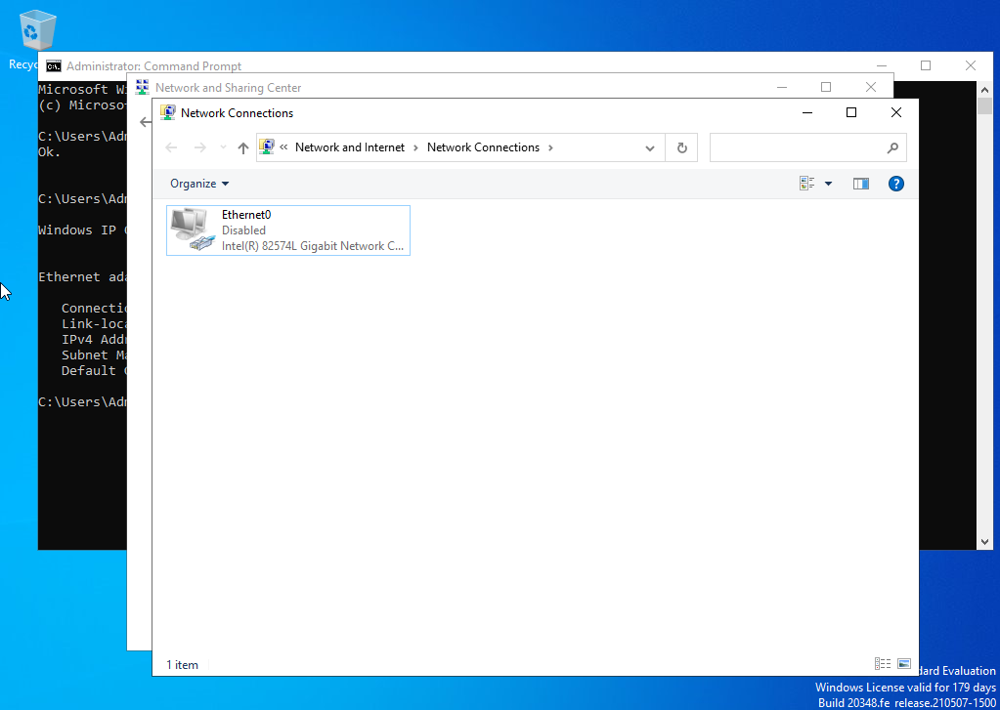
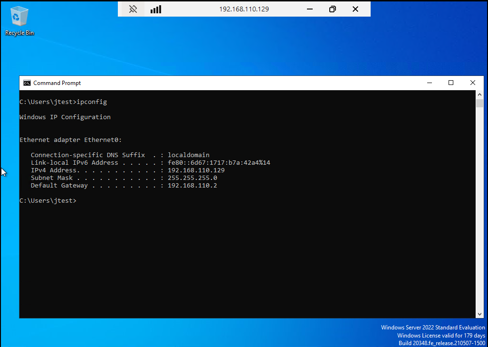
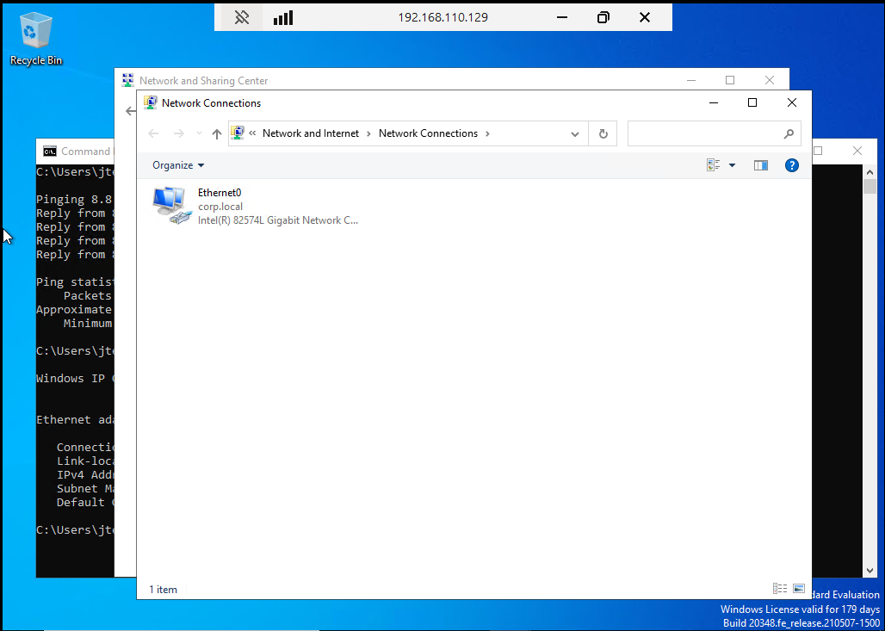
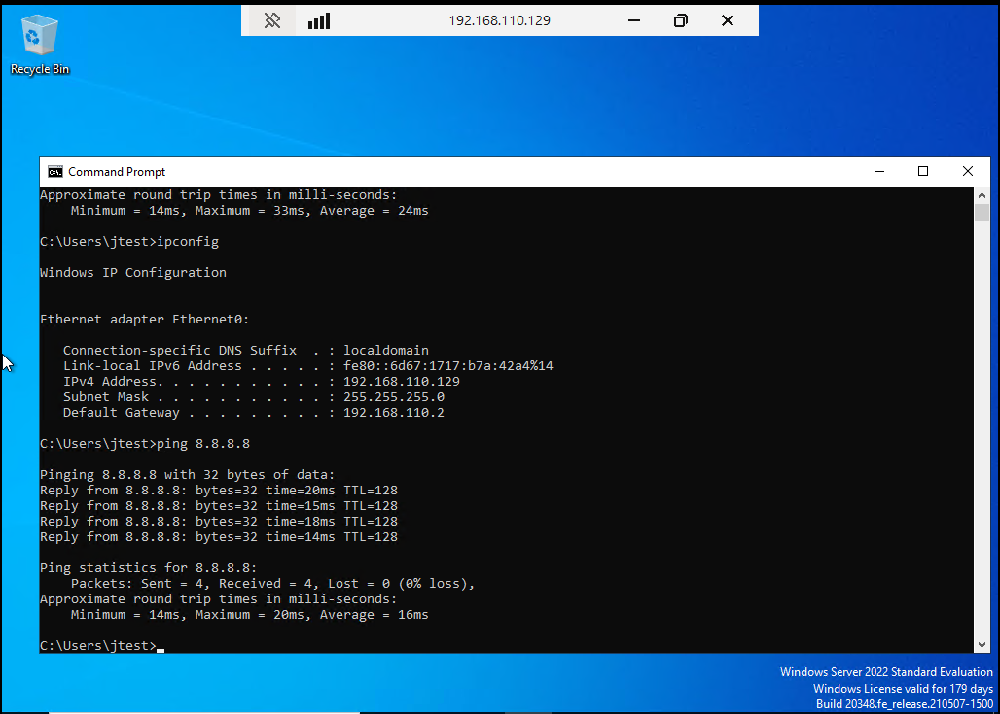

# Lab 07 — Remote IT Support Simulation

A simulated Tier 1/Tier 2 remote support ticket: a user reports lost internet access, and the technician connects over Remote Desktop (RDP), isolates the fault to a disabled network adapter, restores it, and verifies recovery with measurable connectivity tests.

> **Scope:** Home-lab simulation on VMware. It demonstrates a repeatable remote-troubleshooting workflow in a controlled environment, not a production incident.

---

## At a Glance

| | |
|---|---|
| **Role relevance** | Help Desk / Service Desk, Desktop Support, IT Support Tier 1–2 |
| **Problem class** | Loss of network connectivity (physical/data-link/network layer fault) |
| **Root cause** | Network adapter `Ethernet0` in a **Disabled** state |
| **Resolution** | Adapter re-enabled; IP configuration and internet reachability verified |
| **Verification** | `ping 8.8.8.8`: 4 sent, 4 received, **0% loss**, 14–20 ms (avg 16 ms) |
| **Tools** | RDP, Command Prompt, `ipconfig`, `ping`, Windows Network Connections |
| **Environment** | VMware Workstation Player, NAT networking, Windows 11 workstation connecting to a Windows Server 2022 VM |

---

## Scenario

**User report:** "My computer has lost internet access."

**Technician objective:** Gain remote access, find the cause without physically touching the machine, restore service, prove the fix worked, and document it the way a ticket would be closed.

---

## Lab Environment

| Component | Detail |
|---|---|
| Hypervisor | VMware Workstation Player on a Windows laptop |
| Network | VMware NAT, subnet `192.168.110.0/24`, default gateway `192.168.110.2` |
| Technician workstation | `CLIENT1.corp.local`, Windows 11 VM (the RDP client) |
| Remote target | Windows Server 2022 Standard Evaluation VM (build 20348) at `192.168.110.129` |
| Network adapter | `Ethernet0`, Intel(R) 82574L Gigabit Network Connection (VMware virtual NIC) |
| Domain context | `corp.local` environment shared with the other directory and support labs in this repository |
| Test account | `jtest` (lab account) |

---

## Walkthrough

### 1. Enable and establish remote access

The Windows 11 technician workstation (`CLIENT1.corp.local`) shows Remote Desktop enabled under **Settings > System > Remote Desktop**, which also exposes the PC name and the list of users allowed to connect. An RDP session was then opened from it to the Windows Server 2022 VM at `192.168.110.129`.




**Why it matters:** Remote support depends on prerequisites being in place first: the service enabled, the account authorized, and the target reachable. In an enterprise these are typically set by build standards or Group Policy rather than per machine.

### 2. Identify the fault

With the remote session unavailable, **Network Connections** was checked from the VM console and showed `Ethernet0` (Intel 82574L) with a status of **Disabled**.



**Why it matters:** Checking adapter state first is the fastest way to separate "the NIC is off" from "the NIC is on but misconfigured." If the adapter is administratively disabled, DHCP renewals, DNS flushes, and gateway tests are wasted effort.

### 3. Verify IP configuration

`ipconfig` was run from Command Prompt in the remote session.



| Field | Observed value |
|---|---|
| IPv4 address | `192.168.110.129` |
| Subnet mask | `255.255.255.0` |
| Default gateway | `192.168.110.2` |
| Connection-specific DNS suffix | `localdomain` |

**Why it matters:** A valid private address, a correct /24 mask, and a gateway in the same subnet indicate the addressing is sound. A `169.254.x.x` (APIPA) address here would instead point to a DHCP problem.

### 4. Remediate

Because a disabled adapter cuts off the RDP session, recovery was performed from the VMware VM console, which is the lab's out-of-band access path. `Ethernet0` was re-enabled there, and Network Connections now reports the adapter as connected to the `corp.local` network instead of Disabled. The RDP session was then available again for verification.



### 5. Verify connectivity

`ping 8.8.8.8` confirmed end-to-end reachability to an external address.



**Why it matters:** A fix is not closed until it is verified. Pinging an external IP confirms the full path (adapter, IP stack, gateway, NAT, and upstream) works, not just that the adapter reads as enabled.

---

## Results

| Check | Before | After |
|---|---|---|
| Adapter state (`Ethernet0`) | Disabled | Enabled, connected to `corp.local` |
| IPv4 configuration | n/a | `192.168.110.129/24`, gateway `192.168.110.2` |
| `ping 8.8.8.8` | n/a | 4/4 replies, 0% loss, 14–20 ms, TTL 128 |

---

## Reference Commands

**Used and shown in the screenshots**

```cmd
ipconfig
ping 8.8.8.8
```

**Equivalent administrative commands (reference only, not captured in this lab)**

```powershell
# Check adapter state (Status: Up / Disabled)
Get-NetAdapter -Name "Ethernet0"

# Re-enable the adapter (requires an elevated session)
Enable-NetAdapter -Name "Ethernet0" -Confirm:$false

# Review addressing, gateway, and DNS
Get-NetIPConfiguration -InterfaceAlias "Ethernet0"

# Verify reachability, and check that RDP's port is open on a target
Test-NetConnection -ComputerName 8.8.8.8
Test-NetConnection -ComputerName <target> -Port 3389
```

```cmd
:: netsh equivalent for re-enabling an adapter
netsh interface set interface name="Ethernet0" admin=enabled
```

---

## Security Considerations

RDP and third-party remote tools are high-value attack surface, so how they are configured matters as much as whether they work.

- **Least privilege:** Limit RDP access to named accounts or a dedicated group (Remote Desktop Users) and avoid shared administrator logins.
- **Network Level Authentication (NLA):** Keep enabled so authentication happens before a full session is created.
- **Exposure:** Never publish TCP 3389 directly to the internet. Reach it through a VPN, Remote Desktop Gateway, or a Zero Trust access layer, with MFA.
- **Firewall scoping:** Restrict inbound 3389 to management subnets.
- **Auditing:** Review Security log Event ID 4624 (Logon Type 10, RemoteInteractive) and 4625 (failed logon), plus the `Microsoft-Windows-TerminalServices-RemoteConnectionManager/Operational` log (Event ID 1149).
- **Third-party remote-access tools (not used in this lab):** Govern unattended-access passwords, connection-approval prompts, and allowlists through policy rather than leaving defaults.
- **This lab:** Ran entirely on an isolated VMware NAT network with no inbound exposure.

---

## Limitations and Production Considerations

- **Recovery path:** A disabled network adapter drops RDP and any other remote-support session, since they all depend on the network. In production, recovery of a down NIC needs an out-of-band path: hypervisor or VM console, iDRAC/iLO, on-site hands, or an endpoint-management agent that can remediate locally. This lab used the VMware VM console as that path; it does not model physical or remote-management-controller recovery.
- **Root cause:** Re-enabling the adapter restores service but does not explain why it was disabled. A full investigation would check Event Viewer (System log), recent driver or update changes, power-management settings, and whether a policy or endpoint tool is disabling it.
- **Documentation:** A real ticket would record the reported symptom, user impact, root cause, fix, verification, and any follow-up, and confirm resolution with the user before closing.
- **Scale:** One VM and one fault. Fleet-wide detection of disabled adapters would use PowerShell, an RMM tool, or monitoring rather than manual checks.

---

## Skills Demonstrated

| Skill | Evidence in this lab |
|---|---|
| Remote support workflow | RDP enabled and used to reach and administer a remote system |
| Network troubleshooting | Adapter-state check, IP configuration review, external reachability test |
| Command-line diagnostics | `ipconfig`, `ping`, and interpretation of their output |
| Fault isolation | Root cause narrowed to a disabled adapter rather than a configuration or upstream issue |
| Verification discipline | Fix confirmed with a measurable result (0% packet loss) |
| Security awareness | Documented RDP and remote-tool risks and hardening practices |
| Technical documentation | Structured, screenshot-backed write-up in ticket-style order |

---

## Related Labs

- [Lab 03: Windows Network Troubleshooting](../Lab-03-Network-Troubleshooting/)
- [Lab 08: DNS and Network Connectivity Troubleshooting](../Lab-08-DNS-and-Network-Connectivity-Troubleshooting/)
- [Lab 13: Help Desk Ticket Workflow Simulation](../Lab-13-Help-Desk-Ticket-Workflow-Simulation/)
- [Lab 20: Configuring and Troubleshooting RDP on Windows Server 2022](../Lab-20-Configuring-and-Troubleshooting-Remote-Desktop-Protocol-on-Windows-Server-2022/)
- [Lab 21: PowerShell Windows Health Check Automation](../Lab-21-PowerShell-Windows-Health-Check-Automation/)

---

## Conclusion

This lab walks a complete remote-support loop: gain access, isolate the cause, fix it, and verify it with evidence. It reinforces the habits that matter in help desk and junior systems roles: check the simplest layer first, confirm every fix with a measurable test, and understand the security implications of the tools used to do the work.
