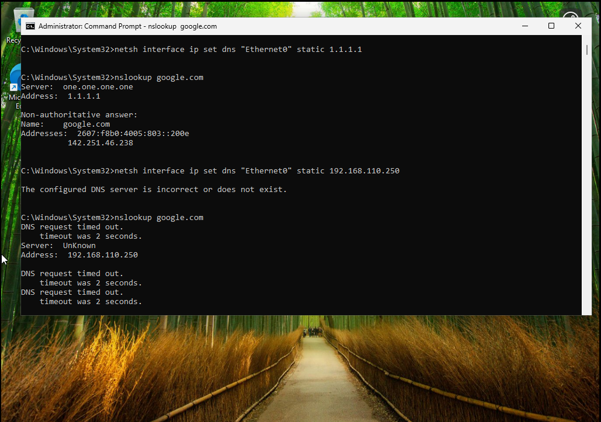
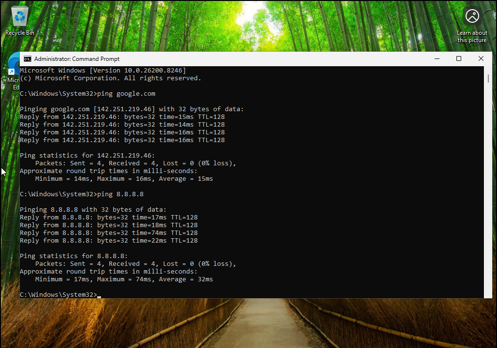
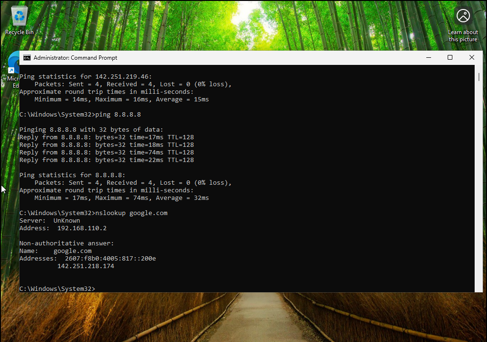
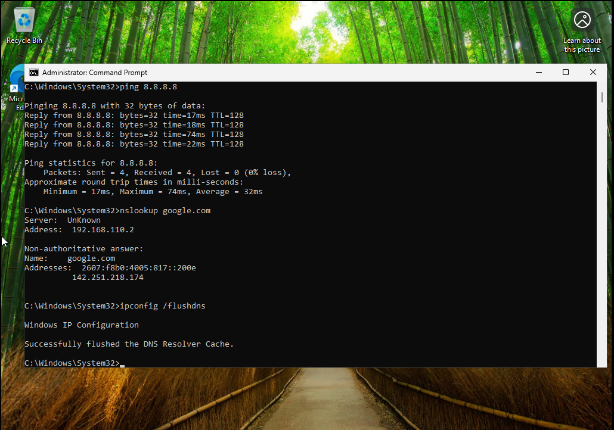

# DNS and Network Connectivity Troubleshooting

## Operational Summary

| | |
|---|---|
| **Problem** | A domain-connected Windows client experiences name-resolution problems even though IP connectivity can work. |
| **Solution** | Separate IP reachability from DNS resolution, inspect the resolver configuration and lookup results, then correct the DNS configuration. |
| **Testing** | Compare the failure state, working IP connectivity, `nslookup` output, and post-change DNS configuration shown in the screenshots. |
| **Documented result** | The original lab reports that the DNS issue was resolved. The screenshots document the failure, investigation, and change, but do not separately show a clearly labeled post-fix name-resolution retest. |
| **Scope** | VMware NAT lab with Windows Server 2022 domain controller and domain-joined Windows client. |

## Environment

- Windows Server 2022 domain controller and DNS environment
- Domain-joined Windows 10/11 client
- `corp.local` lab domain
- VMware Workstation Player, NAT network
- Command Prompt, PowerShell, DNS Manager
- Diagnostic utilities: `ipconfig`, `ping`, `nslookup`, `tracert`

## Troubleshooting Workflow and Evidence

### 1. Establish the failure

Observe that name-based connectivity is failing before changing the client configuration.



### 2. Separate network connectivity from name resolution

Test an IP address directly. If IP reachability works but a hostname does not, DNS becomes a leading hypothesis rather than assuming the entire network is down.



### 3. Inspect DNS resolution

Use `nslookup` to investigate the resolver being queried and the returned lookup result.

```powershell
ipconfig /all
nslookup <hostname>
```

Replace `<hostname>` with the intended internal test name when running the command.



### 4. Correct the DNS configuration

Review the client DNS server settings and the DNS service/records as appropriate to the observed fault. The existing lab evidence records a DNS configuration correction.



## Verification and Result

| Validation step | Documentation status |
|---|---|
| DNS-related connectivity failure | Screenshot included |
| Direct IP connectivity | Screenshot included |
| Resolver lookup investigation | Screenshot included |
| DNS configuration change | Screenshot included |
| Independent post-fix lookup and successful domain-name access | **Not separately evidenced in this README** |

The original exercise reports a resolved DNS issue. To make that result independently verifiable, add a post-fix `nslookup` capture and a successful connection to the intended hostname. Do not treat a configuration screenshot alone as proof of successful DNS resolution.

## Why This Matters in IT Operations

DNS problems often appear to end users as failed web access, inability to reach file shares, or domain-resource failures. Checking IP connectivity first helps avoid unnecessary adapter resets or broader network changes. In Active Directory environments, confirm that domain clients use the intended internal DNS resolvers.

## Skills Demonstrated

Windows DNS troubleshooting, hypothesis-driven diagnosis, DNS client configuration, name resolution testing, domain connectivity, and evidence-based incident documentation.
